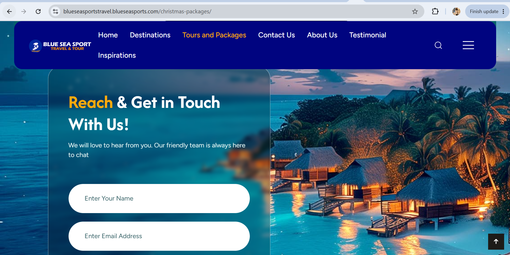
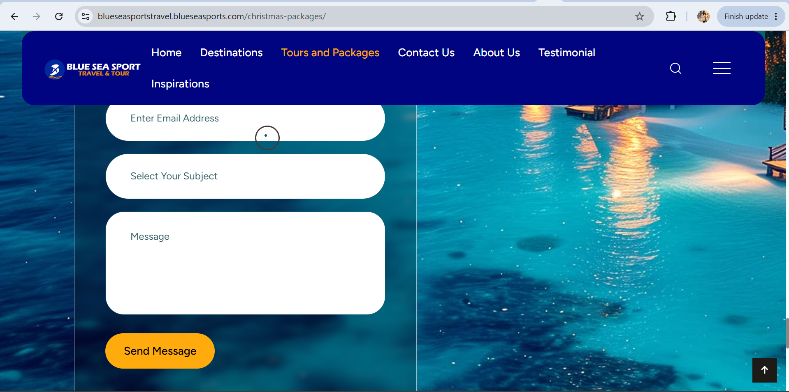

# BLUESEA SPORTS TRAVEL & TOURS

## Selected Website Copywriting Samples

These samples showcase my copywriting approach for Bluesea Sports Travel & Tours, focusing on homepage messaging and travel package descriptions.

---

## 1. Homepage Copywriting

### Main Headline

**It's Time to Travel. Plan Your Next Vacation.**

### Supporting Copy

Every journey begins with a dream. Whether you're planning a relaxing holiday, an exciting adventure, or an unforgettable international getaway, Bluesea Sports Travel & Tours is here to help make your travel plans a reality.

From flights and hotel bookings to visa assistance and holiday packages, we help you navigate your travel journey with greater ease.

### Call to Action

**Start Planning Your Next Trip**

### Homepage Visuals

---

## 2. Christmas Holiday Packages

### Headline

**Make This Christmas a Journey to Remember.**

### Package Description

This festive season, give yourself and your loved ones something special: the opportunity to explore somewhere new.

Whether you envision a memorable family holiday, a relaxing escape, or an exciting international adventure, our Christmas packages help you make the most of the season.

Start planning early and make this Christmas one worth remembering.

**CTA: Explore Christmas Packages**

### Christmas Package Visual

---

## 3. New Year Packages

### Headline

**Start the New Year Somewhere Extraordinary.**

### Package Description

A new year brings new possibilities, and what better way to embrace them than by discovering a new destination?

Whether you're looking forward to a peaceful getaway or an exciting holiday experience, explore our New Year travel packages and start the year with memories that last.

**CTA: Discover New Year Packages**

---

## 4. Group Travel Packages

### Headline

**Better Adventures Are Shared.**

### Package Description

Some experiences are even more memorable when shared.

Bring your friends, family, colleagues, or travel companions together for an exciting group getaway. From discovering new destinations to enjoying unforgettable moments, our group travel packages make planning your next shared adventure easier.

**CTA: Explore Group Packages**

---

## 5. Couples' Packages

### Headline

**Make Time for Each Other. Discover Somewhere Beautiful.**

### Package Description

Sometimes, all you need is a change of scenery and quality time with someone special.

Whether you're celebrating an anniversary, planning a romantic escape, or simply looking to create beautiful memories together, explore destinations that make every moment count.

**CTA: Explore Couples' Packages**

### Couples' Package Visual

### Call-to-Action Examples

---

## Copywriting Skills Demonstrated

* Website and homepage copywriting
* Travel and tourism copywriting
* Promotional content writing
* Brand messaging
* Headline development
* Audience-focused communication
* Call-to-action writing

**Project Role:** Website Copywriter
**Brand:** Bluesea Sports Travel & Tours
